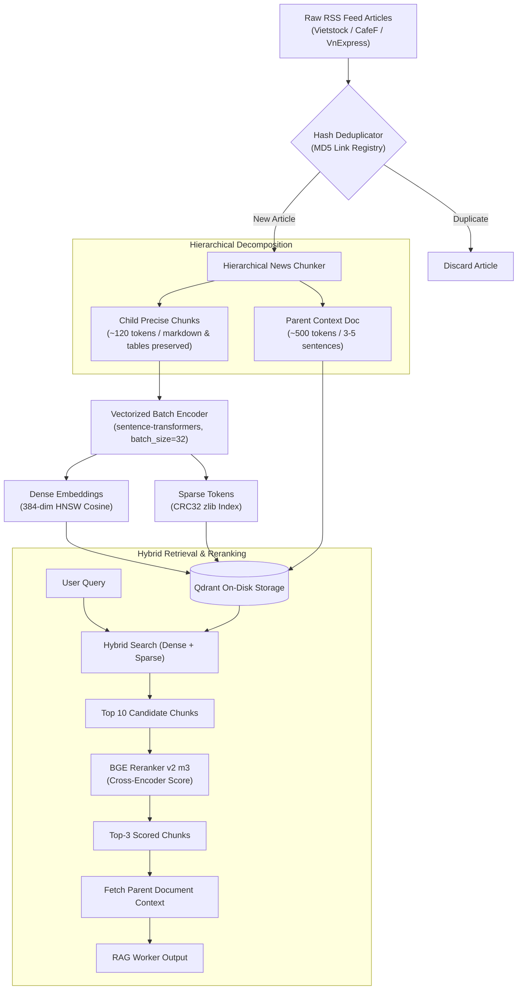
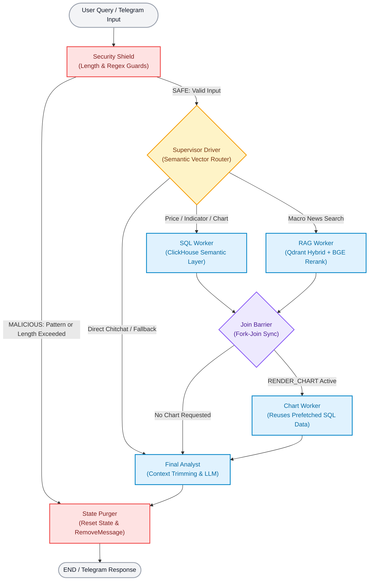

# FinAgent: Financial Data Multi-Agent & Stream Pipeline

## Project Overview

A **Real-time Financial Ingestion Pipeline & Multi-Agent Intelligence System**. This project ingests live cryptocurrency trades, Vietnamese stock quotes, and financial news feeds, processes them through an **Apache Kafka** streaming broker, enriches market data with technical indicators using a **Redis/In-memory hybrid cache**, stores structured market bars in **ClickHouse** (ReplacingMergeTree) and semantic knowledge in **Qdrant** (dense + sparse hybrid vectors with BGE cross-encoder reranking), and exposes an interactive **LangGraph-based Multi-Agent intelligence network** accessible via an asynchronous **Telegram Bot** interface with telemetry monitored by **Langfuse**.

**Business Goal:** Deliver real-time quantitative indicator tracking and semantic RAG macro-insights directly to traders and analysts through a natural language interface, coordinating specialist agents to execute parameterized database queries, perform hybrid vector search, generate multi-panel technical charts, and output synthesized financial assessments.

---

## Architecture & Tech Stack

```mermaid
flowchart TB
    %% ==========================================
    %% TIER 1: INGESTION
    %% ==========================================
    subgraph S1 ["1. Real-time Streaming Ingestion Layer"]
        direction LR
        Src["Market & News Sources<br/>(Binance WS | vnstock | RSS)"]
        Kafka{"Apache Kafka Broker<br/>(Streaming Topics & DLQ)"}
        Src -->|Live Streams| Kafka
    end

    %% ==========================================
    %% TIER 2: STORAGE & CACHE
    %% ==========================================
    subgraph S2 ["2. Processing & Persistent Storage Layer"]
        direction LR
        Consumer["Kafka Stream Consumer<br/>(Technical Indicators Engine)"]
        RedisCache[("Redis Cache<br/>(Sliding Window 30)")]
        ClickHouse[("ClickHouse OLAP<br/>(Gold Layer: prices)")]
        Qdrant[("Qdrant Vector DB<br/>(Hybrid Dense + Sparse)")]

        Consumer <-->|Sliding Buffer| RedisCache
        Consumer -->|Technical Bars| ClickHouse
        Consumer -->|News Chunks| Qdrant
    end

    %% ==========================================
    %% TIER 3: MULTI-AGENT NETWORK
    %% ==========================================
    subgraph S3 ["3. Multi-Agent Intelligence Layer (LangGraph)"]
        direction LR
        Security["Security Shield<br/>(Regex & Length Guards)"]
        Supervisor{"Supervisor Driver<br/>(Semantic Vector Router)"}
        Workers["Specialist Worker Agents<br/>(SQL | RAG | Chart)"]
        Analyst["Final Analyst Agent<br/>(Context Trimming & Multi-LLM)"]
        Checkpointer[("Redis / Memory<br/>(Session Checkpointer)")]

        Security -->|Safe Query| Supervisor
        Supervisor -->|Task Dispatch| Workers
        Workers -->|Evidence & Charts| Analyst
        Analyst <-->|State Snapshot| Checkpointer
    end

    %% ==========================================
    %% TIER 4: USER INTERFACE & TELEMETRY
    %% ==========================================
    subgraph S4 ["4. Client Interface & Telemetry"]
        direction LR
        Telegram["Telegram Bot Interface<br/>(Async UI & Photo Delivery)"]
        Langfuse["Langfuse Server<br/>(Latency, Token Budget & Telemetry)"]
    end

    %% Cross-tier vertical pipelines
    S1 ==>|Real-time Ingestion Stream| S2
    S2 ==>|Data & Knowledge Access| S3
    Telegram <==|Natural Language Dialogue| S3
    S3 -.->|Execution Traces & Costs| Langfuse

    %% Styling
    classDef layer1 fill:#F3F4F6,stroke:#9CA3AF,stroke-width:2px,color:#111827;
    classDef layer2 fill:#FEF3C7,stroke:#F59E0B,stroke-width:2px,color:#78350F;
    classDef layer3 fill:#E0F2FE,stroke:#0284C7,stroke-width:2px,color:#0369A1;
    classDef layer4 fill:#F3E8FF,stroke:#9333EA,stroke-width:2px,color:#581C87;

    class S1 layer1;
    class S2 layer2;
    class S3 layer3;
    class S4 layer4;
```

* **Streaming Orchestration:** 
* **Real-time Cache:** 
* **Columnar DB:** 
* **Vector DB:** 
* **Agent Framework:**  + 
* **Deployment & Containers:** 
* **Language & Config:**  + 

---

## Multi-Agent Routing & Intent Decision Matrix

The coordination network uses a hybrid routing strategy combining a **sub-3ms Semantic Vector Router** (`SemanticVectorRouter`) for fast single/multi-intent identification and an **LLM Reasoning Fallback** for ambiguous queries:

| Detected Intent | Sample User Query | Routing Mechanism | Target Worker Node | Underlying Tool / Data Source |
| :--- | :--- | :--- | :--- | :--- |
| `FETCH_PRICE` / `FETCH_INDICATOR` | *"What is the latest price and RSI for HPG?"* | Fast-Path Vector Embedding Similarity (`score >= 0.55`) | **SQL Worker** | ClickHouse Semantic Layer (`tool_get_ticker_prices`, `tool_get_ticker_indicators`) |
| `RENDER_CHART` | *"Draw a technical chart with MACD and SMA for SSI"* | Fast-Path Vector Embedding Similarity (`score >= 0.55`) | **Chart Worker** | Headless Matplotlib Renderer (`tool_generate_market_chart`) |
| `FETCH_NEWS` | *"Summarize recent news regarding State Bank of Vietnam interest rates"* | Fast-Path Vector Embedding Similarity (`score >= 0.55`) | **RAG Worker** | Qdrant Dense+Sparse Hybrid Index + BGE Reranker |
| `MULTI_INTENT` | *"Analyze FPT stock price, show chart, and evaluate recent AI cloud expansion news"* | Clause Splitting + Fast-Path Centroid Similarity | **Dynamic Fan-out** (SQL + Chart + RAG concurrently $\rightarrow$ Analyst) | Parallel execution across ClickHouse, Matplotlib, and Qdrant |
| `CHITCHAT` / `AMBIGUOUS` | *"Xin chào bạn, hôm nay thời tiết thế nào?"* | Fast-Path Centroid or LLM Reasoning Fallback (`qwen2.5-coder:1.5b`) | **Analyst Worker** | Direct dialogue synthesis with Redis chat checkpointer |

* **Similarity Thresholding (`SEMANTIC_ROUTER_THRESHOLD = 0.55`):** Queries matching precomputed intent centroids above this threshold route directly to worker nodes without LLM inference overhead (< 10ms).
* **Multi-Intent Delta Clustering (`ROUTER_SECONDARY_DELTA = 0.06`):** Evaluates multi-clause statements; secondary intents within 0.06 of top score trigger parallel execution.
* **Fallback Margin (`ROUTER_FALLBACK_MARGIN = 0.10`):** Queries scoring within 0.10 below the primary threshold trigger structured LLM fallback reasoning (`qwen2.5-coder:1.5b-instruct`).
* **Unrecognized Ticker Fallback:** If quantitative or charting intent is detected but no valid ticker symbol can be extracted (`target_ticker == "UNKNOWN"`), the router automatically delegates to LLM reasoning to disambiguate the target asset.

---

## 3-Layer RAG & Ingestion Data Contract

The unstructured knowledge pipeline converts financial RSS news feeds into queryable semantic representations:



---

## Dynamic Multi-Panel Technical Charting Modes

The `ChartAgent` module renders multi-panel financial charts via thread-safe, object-oriented Matplotlib with support for dynamic session-isolated file paths:

| Chart Mode | Panel Layout | Visual Indicators Included | Primary Use Case |
| :--- | :---: | :--- | :--- |
| `comprehensive` | 2-Panel Vertical | Top: Price Candles + SMA-5/20 + Bollinger Bands<br>Bottom: MACD Histogram & Signal Line | Holistic market momentum and trend analysis |
| `price_sma` | 1-Panel Single | Close Prices + 5-day & 20-day Simple Moving Averages | Quick trend direction and Golden/Death cross inspection |
| `rsi` | 2-Panel Vertical | Top: Price line<br>Bottom: 14-period RSI with 70 Overbought & 30 Oversold thresholds | Mean reversion and overextended price detection |
| `macd` | 2-Panel Vertical | Top: Price line<br>Bottom: MACD Line, Signal Line, and Positive/Negative Momentum Bars | Momentum convergence and divergence confirmation |
| `volume` | 2-Panel Vertical | Top: Price line<br>Bottom: Color-coded trading volume bars | Liquidity confirmation and breakout validation |

* **Prefetched Data Reuse:** When executed in compound multi-intent workflows, `Chart Worker` directly reuses quantitative records fetched by `SQL Worker` (`prefetched_data=state["sql_data_output"]`), completely avoiding duplicate database reads.
* **Thread-Safe Session Isolation:** Renders into dynamically generated UUID image paths (`data/exports/market_chart_{uuid}.png`) and unlinks files immediately upon transmission via `_send_and_cleanup_chart`, preventing race conditions and unbounded disk usage.

---

## Pipeline Workflow

### 1. Real-time Ingestion (Producers)
* **Binance WS Stream:** Connects directly to Binance WebSockets, listening to live ETHUSDT and BTCUSDT trades. Formats records to match the ingestion data contract and publishes them to the `finagent_bronze_market` topic.
* **vnstock Polling Stream:** Polls price boards for high-liquidity Vietnamese stock tickers (SSI, VND, HPG, FPT, etc.) using vnstock. Formats records and publishes them to the market topic.
* **RSS Feeds Stream:** Parses economic feeds (CafeF, Vietstock, VnExpress) every 15 seconds. Uses an in-memory MD5 hash registry to filter out duplicate news links and publishes new stories to the `finagent_bronze_news` topic.

### 2. Stream Ingestion & Caching (Kafka Consumer)
* **At-Least-Once Delivery:** Auto-commits are disabled (`enable_auto_commit=False`). Offsets are manually committed *only* after database inserts succeed.
* **Dead Letter Queue (DLQ):** Failed schemas, parsing failures, and contract mismatches are caught, packed with failure diagnostics, and routed to dedicated DLQ topics (`finagent_market_dlq`, `finagent_news_dlq`).
* **Sliding Window Caching:** Utilizes `PriceCacheManager` with **Redis Sorted Sets (ZSET)** indexed by timestamp scores to maintain a sliding window of the last 30 prices per symbol. If Redis is unavailable, it gracefully falls back to an **in-memory process dictionary** (safely sorting and deduplicating). ClickHouse is queried *only once* on cache miss (lazy loading) to warm up the cache, eliminating repetitive database hits.
* **Incremental Indicator Calculation:** Recalculates technical metrics (SMA-5, SMA-20, RSI, MACD) on the 30-item sliding window, and bulk-inserts the enriched records into ClickHouse.

### 3. Semantic Layer Ingestion (Vector Database)
* **Hierarchical Chunking:** Processes ingested news articles into child chunks for precision embeddings while preserving the broader parent document context to avoid context fragmentation.
* **Batch Vector Encoding & Hybrid Indexing:** Encodes document chunks in vectorized batches (`batch_size=32`) via `sentence-transformers`, generating dense embeddings alongside sparse vectors built via `zlib.crc32` with collision weight aggregation. Stores both dense and sparse indices directly on disk in Qdrant.
* **Shared Embedding Singleton:** Shares the loaded `SentenceTransformer` instance between Qdrant vector retrieval and the Semantic Vector Router, cutting ~120MB of duplicate model RAM.

### 4. LangGraph Multi-Agent Orchestration



* **Security Shield:** Sub-millisecond deterministic regex and length validation (`MAX_INPUT_LENGTH = 1000`) guarding against SQL injection and jailbreaks. Blocked requests immediately bypass execution and transition to `state_purger`.
* **Supervisor Agent & Fast Semantic Router:** Evaluates intent via `SemanticVectorRouter` with lazy-loaded embeddings and precomputed centroids (`@functools.cached_property`), clause splitting, and fallback to structured reasoning (`qwen2.5-coder:1.5b-instruct`) when tickers are ambiguous.
* **Dynamic Conditional Fan-out & Join Barrier:** Branches execution concurrently to `SQL Worker` (for price, indicators, or chart data) and `RAG Worker` (for news context). Execution flows through a synchronized `Join Barrier` before conditionally triggering `Chart Worker` or proceeding directly to `Final Analyst`.
* **SQL Worker:** Executes parameterized queries against ClickHouse via Semantic Layer tools (`tool_get_ticker_prices`, `tool_get_ticker_indicators`) using non-blocking async execution (`asyncio.to_thread`) and bounded retry backoff.
* **RAG Worker:** Executes hybrid dense/sparse searches against Qdrant, reranks candidates using a cross-encoder model (`bge-reranker-v2-m3`), and fetches expanded parent document context.
* **Chart Worker & Prefetched Data Reuse:** Dynamically renders technical charts using headless Matplotlib. If `SQL Worker` has already retrieved indicator data in parallel fan-out, `Chart Worker` consumes `prefetched_data` directly, avoiding redundant ClickHouse reads.
* **Analyst Agent & In-Flight Context Trimming:** Synthesizes final reports combining verified ClickHouse metrics and Qdrant macro context. Applies `trim_messages` to constrain chat history within an 800-token budget while isolating untrusted news within `<untrusted_news_context>` tags. Supports runtime switching between Local Ollama (`qwen2.5:1.5b-instruct`) and Cloud AI (OpenAI, Gemini, DeepSeek, Groq).
* **State Purger & Conversation Bounding:** Resets transient execution outputs between turns and prunes persisted conversation history exceeding `MAX_HISTORY_MESSAGES` (20) in the checkpointer using LangGraph `RemoveMessage` primitives.

---

## Key Engineering Highlights

* **Prefetched Data Reuse across Multi-Agent Fan-out:** In compound requests requiring both quantitative lookup and charting, Chart Worker consumes cached indicator data from SQL Worker directly via `AgentState`, eliminating duplicate database queries.
* **Bounded Checkpointer Memory via Pruning:** State Purger systematically emits LangGraph `RemoveMessage` objects to bound Redis conversation state within `MAX_HISTORY_MESSAGES` (20), preventing memory leaks in long-running chat sessions.
* **Telegram Boundary-Aware Message Splitting:** Automatically partitions long analyst briefings into clean chunks under 4000 characters along newline boundaries (`split_telegram_message`), guaranteeing zero dropped messages.
* **Deterministic Input Security Guardrails:** Combines rule-based regex patterns for SQL injection (`UNION SELECT`, `INSERT INTO`) and prompt jailbreaks (`disregard rules`, `act as DAN`) with length bounds (`MAX_INPUT_LENGTH = 1000`) for sub-millisecond fail-fast rejection.
* **Thread-Safe Dynamic Chart Generation:** Generates chart image files with session-isolated target paths (`chart_path` in `AgentState`) and safely cleans them up after transmission, preventing concurrent user file collisions and race conditions.
* **Deterministic Parameterized SQL Matching:** Eliminates SQL dialect syntax issues and injection risks by enforcing parameter-driven execution with strict case-insensitive symbol matching and subquery chronological ordering.
* **Multi-Provider LLM Switcher:** Users can toggle between Local Ollama and Cloud AI providers dynamically via Telegram UI buttons (`/model`) or environment configurations.
* **Strict Python 3.10+ Literal Typing:** State schema employs static `Literal` types for `Intent`, `ChartMode`, `SecurityStatus`, `NextWorker`, and `AnalystProvider`, eliminating string-based runtime state errors.
* **3-Layer RAG Quality Gate:** Automated evaluation testing IR metrics (Hit@1, Hit@2, MRR), fact recall, and latency guards.
* **High-Throughput Batch Vectorization:** Replaces per-item encoding with batched tensor calculations (`batch_size=32`), achieving 5x–10x faster vector database ingestion.
* **Zero-Leak Stream Buffers:** Protects continuous 24/7 RSS ingestion using a bounded sliding FIFO dictionary to prevent memory leaks.
* **Resilient Offset Commit Policy:** Commits Kafka offsets manually *after* data persistence succeeds, assuring zero data loss (At-Least-Once).
* **Robust DLQ Design:** Isolates malformed events into dedicated DLQ topics to prevent ingestion pipeline blocking.
* **ClickHouse Query Offloading:** Integrates a write-through hybrid cache (Redis ZSET / In-memory fallback) to eliminate database queries inside the streaming loop.
* **Pydantic v2 Centralized Settings:** Type-safe environment variable parsing with automatic directory bootstrapping (`data/exports/`, `logs/`).

---

## Project Structure

```
financial-data-agent-system/
│
├── src/
│   ├── agent/                         # Multi-Agent Coordination Network
│   │   ├── nodes/
│   │   │   ├── analyst.py             # Coordinator: synthesizes reports, manages session states & state purging
│   │   │   ├── chart_worker.py        # Chart Agent: generates technical charts with dynamic paths & prefetched data reuse
│   │   │   ├── driver.py              # Supervisor Agent: routes to specialist workers (Fast-Path + LLM Fallback)
│   │   │   ├── rag_worker.py          # RAG Agent: performs sparse/dense hybrid searches
│   │   │   ├── security.py            # Guardrail Agent: validates prompt length and regex security
│   │   │   └── sql_worker.py          # SQL Agent: queries prices and indicators via Semantic Layer
│   │   ├── callbacks.py               # Langfuse tracing integrations
│   │   ├── graph.py                   # LangGraph assembly (state machine, dynamic fan-out, barrier, checkpointer)
│   │   ├── prompts.py                 # Multi-Intent and agent system prompts
│   │   ├── router.py                  # Sub-3ms Semantic Vector Router with Multi-Threshold & Clause Splitting
│   │   └── state.py                   # AgentState schema with strict Literal types
│   │
│   ├── config/
│   │   ├── __init__.py                # Settings package initialization & exports
│   │   └── settings.py                # Centralized Pydantic v2 settings & directory bootstrapping
│   │
│   ├── utils/
│   │   ├── __init__.py                # Utilities package initialization
│   │   ├── chunking.py                # Hierarchical news chunker (preserves markdown/tables)
│   │   └── logger.py                  # Standardized logging wrapper
│   │
│   ├── consumer.py                    # Kafka Consumer with Manual Commits, DLQ & PriceCacheManager
│   ├── database.py                    # ClickHouse schema definition (ReplacingMergeTree) and ingest engine
│   ├── producer.py                    # Binance WS, vnstock polling, RSS financial feeds producer
│   ├── telegram_bot.py                # Telegram Bot handler running LangGraph workflows async & message chunking
│   ├── tools.py                       # SQL execution, hybrid vector retrieval, dynamic chart rendering
│   └── vector_db.py                   # Qdrant hybrid (dense + sparse index HNSW) schema & ingest
│
├── tests/                             # Full Unit & Evaluation Test Suite (64 tests passed)
│   ├── evaluate.py                    # 3-Layer RAG Quality Gate Evaluation Suite
│   ├── seed_data.py                   # Test dataset initialization fixtures
│   ├── test_chunking.py               # Markdown table and hierarchical chunking tests
│   ├── test_consumer.py               # Ingestion stream, DLQ, and cache manager tests
│   ├── test_database.py               # ClickHouse query and schema tests
│   ├── test_prompt_integrity.py       # Prompt contracts and multi-agent node integrity tests
│   ├── test_router.py                 # Semantic Vector Router and Context Trimming tests
│   ├── test_security_guard.py         # Security injection guardrails and route plan tests
│   ├── test_telegram_integration.py   # Telegram bot async lifecycle, checkpointer & message splitting tests
│   ├── test_tools.py                  # Semantic layer tools and dynamic chart rendering tests
│   └── test_vector_db.py              # Qdrant hybrid vector search tests
│
├── docs/                              # Project Documentation & Architecture Reviews
│   └── adversarial_review.md          # Adversarial Architecture Assessment & Production Review
│
├── conftest.py                        # Global Pytest fixtures & environment setup
├── docker-compose.yml                 # Infrastructure stack (Kafka, ClickHouse, Redis, Qdrant, Postgres, Langfuse)
├── main.py                            # Unified bootstrap entrypoint (DB init + Vector init + Bot start)
├── requirements.txt                   # Project package dependencies
├── .env.example                       # Environment configuration template
└── .env                               # Environment configurations (tokens, database credentials)
```

---

## Data Contracts & Storage Schemas

### 1. ClickHouse Gold Layer: `prices` Table
Stores high-frequency market prices and incrementally calculated technical indicators:

| Column | Type | Nullable | Description |
| :--- | :--- | :---: | :--- |
| `timestamp` | `DateTime` | No | Timestamp of the price observation (UTC) |
| `symbol` | `String` | No | Asset ticker symbol (e.g., `BTCUSDT`, `ETHUSDT`, `HPG`, `SSI`) |
| `price` | `Float64` | No | Last trade / closing price |
| `volume` | `Float64` | No | Executed trading volume |
| `SMA_5` | `Nullable(Float64)` | Yes | 5-period Simple Moving Average |
| `SMA_20` | `Nullable(Float64)` | Yes | 20-period Simple Moving Average |
| `RSI` | `Nullable(Float64)` | Yes | 14-period Relative Strength Index (0–100) |
| `MACD` | `Nullable(Float64)` | Yes | Moving Average Convergence Divergence line |
| `MACD_Signal` | `Nullable(Float64)` | Yes | 9-period Exponential Moving Average signal line |

* **Engine:** `ReplacingMergeTree()`
* **Primary / Sorting Key:** `(symbol, timestamp)`

---

### 2. Qdrant Vector Collection: `financial_reports`
Stores dense embeddings, sparse tokens, and hierarchical parent-child article payloads:

| Vector / Payload Field | Type / Dimension | Indexing Strategy | Description |
| :--- | :--- | :--- | :--- |
| `dense` | `Vector(384)` | HNSW (Cosine Distance) | Dense semantic vector (`all-MiniLM-L6-v2`) |
| `sparse` | `SparseVector` | Inverted Index (On-Disk) | Lexical token weights generated via `zlib.crc32` |
| `parent_id` | `String (MD5/UUID)` | Keyword Match | Unique identifier linking child chunks to parent document |
| `chunk_id` | `String / Integer` | Keyword Match | Child chunk sequence index within parent article |
| `source` | `String` | Keyword Filter | News publisher (e.g., `CafeF`, `Vietstock`, `VnExpress`) |
| `title` | `String` | Fulltext Search | Headline / Article title |
| `url` | `String` | Exact Match | Canonical web URL of the original news story |
| `published_at` | `String (ISO 8601)` | Datetime Filter | Article publication timestamp |
| `content` | `String (~120 tokens)` | Stored Text | Child precise chunk text (markdown & tables preserved) |
| `parent_content` | `String (~500 tokens)` | Stored Context | Complete parent article context passed to Analyst LLM |

---

## Environment Configuration Reference

The system utilizes centralized Pydantic v2 settings (`src/config/settings.py`) loaded from `.env`:

| Variable | Category | Type | Default Value | Description |
| :--- | :--- | :---: | :--- | :--- |
| `DB_HOST` | Database | `str` | `localhost` | ClickHouse host address |
| `DB_PORT` | Database | `int` | `8123` | ClickHouse HTTP interface port |
| `DB_USER` | Database | `str` | `finuser` | ClickHouse username |
| `DB_PASSWORD` | Database | `str` | `finpassword` | ClickHouse user password |
| `DB_NAME` | Database | `str` | `finance_db` | Target database name |
| `TABLE_PRICES` | Database | `str` | `prices` | ClickHouse table name for market price data |
| `DEFAULT_PRICES_LIMIT` | Semantic Layer | `int` | `30` | Default record limit for historical price and indicator queries |
| `QDRANT_HOST` | Vector DB | `str` | `localhost` | Qdrant vector database host |
| `QDRANT_PORT` | Vector DB | `int` | `6333` | Qdrant HTTP interface port |
| `QDRANT_COLLECTION` | Vector DB | `str` | `financial_reports` | Qdrant collection name |
| `EMBEDDING_MODEL_NAME` | Vector DB | `str` | `all-MiniLM-L6-v2` | Sentence-transformers dense embedding model |
| `RERANK_MODEL_NAME` | Vector DB | `str` | `BAAI/bge-reranker-v2-m3` | Cross-encoder reranker model |
| `REDIS_HOST` | Cache / State | `str` | `localhost` | Redis server host |
| `REDIS_PORT` | Cache / State | `int` | `6379` | Redis server port |
| `KAFKA_BROKER` | Streaming | `str` | `localhost:9092` | Kafka broker bootstrap server address |
| `TOPIC_MARKET` | Streaming | `str` | `finagent_bronze_market` | Market prices streaming topic |
| `TOPIC_NEWS` | Streaming | `str` | `finagent_bronze_news` | Financial news streaming topic |
| `TOPIC_MARKET_DLQ` | Streaming | `str` | `finagent_market_dlq` | Dead Letter Queue for malformed price records |
| `TOPIC_NEWS_DLQ` | Streaming | `str` | `finagent_news_dlq` | Dead Letter Queue for malformed news records |
| `LANGFUSE_PUBLIC_KEY` | Observability | `str` | `""` | Langfuse telemetry public key |
| `LANGFUSE_SECRET_KEY` | Observability | `str` | `""` | Langfuse telemetry secret key |
| `LANGFUSE_HOST` | Observability | `str` | `http://localhost:3000` | Langfuse server URL |
| `TELEGRAM_BOT_TOKEN` | Interface | `str` | `None` | Telegram Bot API token from `@BotFather` |
| `LLM_CODER_MODEL` | Local LLM | `str` | `qwen2.5-coder:1.5b-instruct` | Ollama model for structured reasoning fallback |
| `LLM_ANALYST_MODEL` | Local LLM | `str` | `qwen2.5:1.5b-instruct` | Ollama model for report synthesis |
| `LLM_GUARD_MODEL` | Local LLM | `str` | `llama-guard3:1b-q5_K_S` | Ollama model for security guardrails |
| `ANALYST_LLM_PROVIDER` | Multi-Provider | `str` | `local` | Active provider: `local`, `openai`, `gemini`, `deepseek`, `groq` |
| `ANALYST_TEMPERATURE` | Multi-Provider | `float` | `0.3` | Analyst LLM temperature (0.0–1.0) |
| `ANALYST_API_MODEL` | Multi-Provider | `str` | `gpt-4o-mini` | Default model identifier for Cloud AI providers |
| `ANALYST_API_BASE_URL` | Multi-Provider | `str \| None` | `None` | Custom API endpoint base URL for Cloud AI providers |
| `OPENAI_API_KEY` | Cloud AI | `str` | `""` | OpenAI API key for GPT models |
| `GEMINI_API_KEY` | Cloud AI | `str` | `""` | Google Gemini API key |
| `DEEPSEEK_API_KEY` | Cloud AI | `str` | `""` | DeepSeek API key |
| `DEEPSEEK_BASE_URL` | Cloud AI | `str` | `https://api.deepseek.com` | DeepSeek API base URL endpoint |
| `GROQ_API_KEY` | Cloud AI | `str` | `""` | Groq high-speed inference API key |
| `GROQ_BASE_URL` | Cloud AI | `str` | `https://api.groq.com/openai/v1` | Groq API base URL endpoint |
| `MAX_INPUT_LENGTH` | Security | `int` | `1000` | Maximum character length allowed for user input queries |
| `MAX_HISTORY_TOKENS` | Memory Budget | `int` | `800` | Token budget limit for conversation context window trimming |
| `MAX_HISTORY_MESSAGES` | Memory Budget | `int` | `20` | Maximum message count kept in conversation window |
| `SEMANTIC_ROUTER_THRESHOLD` | Routing | `float` | `0.55` | Similarity threshold for fast-path vector routing |
| `ROUTER_SECONDARY_DELTA` | Routing | `float` | `0.06` | Threshold delta for multi-intent centroid clustering |
| `ROUTER_FALLBACK_MARGIN` | Routing | `float` | `0.10` | Margin below threshold to trigger LLM fallback reasoning |
| `TRACKED_STOCK_SYMBOLS` | Market Data | `list[str]` | `["HPG", "FPT", "SSI", "VND", "MBB", "TCB"]` | Tracked stock tickers for real-time polling |
| `VNSTOCK_API_KEY` | Market Data | `str` | `""` | API key for vnstock market feed (optional) |
| `CHART_FILE_PATH` | File Paths | `str` | `data/exports/market_chart.png` | Fallback file path for generated market charts |

---

## Observability & Agent Tracing (Langfuse)

All multi-agent interactions, tool executions, and LLM reasoning steps are traced in real-time with **Langfuse**:

* **Dashboard Access:** Open `http://localhost:3000` in your browser.
* **Trace Hierarchy:** Traces follow the workflow execution path: `Telegram Input` $\rightarrow$ `Security Guard` $\rightarrow$ `Semantic Vector Router` $\rightarrow$ `Specialist Worker(s)` $\rightarrow$ `Analyst Synthesis`.
* **Telemetry Metrics Monitored:**
  * **Latency Breakdown:** Sub-3ms router execution vs tool database query times vs LLM token generation latency.
  * **Token Usage & Costs:** In-flight message trimming statistics and token cost tracking per provider.
  * **Fast-Path vs Fallback Ratio:** Tracks proportion of queries routed via embedding similarity vs LLM fallback.
  * **Error & DLQ Traces:** Real-time visibility into schema validation errors and failed tool calls.

---

## Quickstart & Execution Guide

### 1. Configure the Environment
```bash
git clone <your-repo-url>
cd financial-data-agent-system
cp .env.example .env
# Fill out the .env file with your API keys (Telegram Bot Token, Langfuse, Database credentials)
```

### 2. Launch Infrastructure Services
Ensure Docker Desktop is running, then start the container stack:
```bash
docker compose up -d
```
This boots up:
* **Kafka:** Port `9092` (KRaft broker).
* **ClickHouse:** Ports `8123` (HTTP) & `9000` (Native) for market data storage.
* **Qdrant:** Ports `6333` (HTTP) & `6334` (gRPC) for vector search.
* **Redis:** Port `6379` (Sliding window cache & LangGraph checkpointer).
* **PostgreSQL:** Port `5433` (Langfuse metadata storage).
* **Langfuse:** Port `3000` (Agent monitoring and tracing server).

### 3. Run Unit and Evaluation Test Suites
```bash
# Activate your virtual environment
source venv/bin/activate  # On Windows: venv\Scripts\activate

# Install required dependencies
pip install -r requirements.txt

# Run full pytest unit and integration test suite across all components
PYTHONPATH=. pytest -v

# Run the 3-Layer RAG Quality Gate Evaluation Suite
PYTHONPATH=. python tests/evaluate.py
```

### 4. Run the Stream Pipeline (Optional Standalone)
Launch the real-time producers and consumer in separate terminal sessions:
```bash
# Start Ingestion streams (Producers)
PYTHONPATH=. python src/producer.py

# Start Processing engine (Consumer)
PYTHONPATH=. python src/consumer.py
```

### 5. Launch the Platform & Telegram Bot
Start the unified platform entrypoint to initialize database schemas and start the Telegram Bot:
```bash
PYTHONPATH=. python main.py
```

### 6. Interactive Bot Commands & Chat Scenarios
Search for your bot in Telegram using your configured bot token name and interact:

#### Command Shortcuts:
* `/start` - Displays bot welcome overview and active model status.
* `/model` - Opens the interactive UI Switcher to select between Local Ollama and Cloud AI (OpenAI, Gemini, DeepSeek, Groq).
* `/analyze HPG` - Triggers comprehensive technical analysis with automated chart generation for ticker `HPG`.

#### Sample Natural Language Queries:
* **Quantitative Data Lookup (`FETCH_PRICE` / `FETCH_INDICATOR`):**
  > *"Lấy giá mới nhất và chỉ số RSI của SSI"*
* **Dynamic Technical Charting (`RENDER_CHART`):**
  > *"Vẽ biểu đồ kỹ thuật MACD và đường SMA cho SSI"*
* **Macroeconomic News Synthesis (`FETCH_NEWS`):**
  > *"Tóm tắt các tin tức mới nhất về chính sách điều hành lãi suất của Ngân hàng Nhà nước"*
* **Complex Multi-Intent Analysis (Multi-Intent Fan-out):**
  > *"Phân tích kỹ thuật mã FPT, vẽ biểu đồ và đánh giá các tin tức mở rộng trung tâm dữ liệu AI gần đây"*
* **Conversational Interaction (`CHITCHAT`):**
  > *"Xin chào bạn, hôm nay thời tiết thế nào?"*

