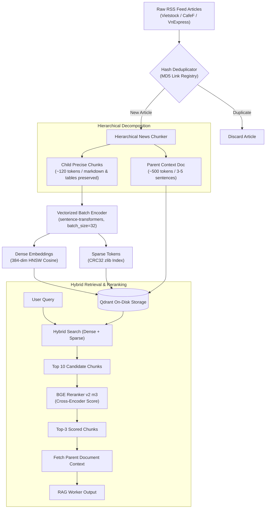

# FinAgent: financial data multi-agent and stream pipeline

## Project overview

FinAgent ingests cryptocurrency trades, Vietnamese stock quotes, and financial news, computes technical indicators over a sliding window, and serves market analysis through a Telegram bot. The system stores market bars in ClickHouse and document chunks in Qdrant. A LangGraph supervisor routes user questions across ClickHouse queries, hybrid vector search, and chart rendering, with traces recorded in Langfuse.

## Architecture and tech stack

```mermaid
flowchart TD
    subgraph IngestionLayer [Real-Time Streaming & Ingestion Broker]
        market_src["Market Feeds & News Producers<br/>(Binance WS | vnstock VN30 | Financial RSS)"]:::source
        kafka_broker["Apache Kafka Broker<br/>(market-bars & financial-news Topics)"]:::stream
        stream_consumer["Stream Processing Consumer<br/>(aiokafka Engine & Technical Indicator Calc)"]:::stream
        dlq["Dead Letter Queue (DLQ)<br/>(finagent-dlq Quarantine Broker)"]:::quality
    end

    subgraph StorageLayer [Dual Storage & Semantic Knowledge Base]
        redis_cache["Redis 7.0 Sliding Window<br/>(ZSET Rolling Buffer: 30 OHLCV Bars)"]:::redis
        clickhouse_olap[("ClickHouse OLAP Database<br/>(ReplacingMergeTree 'prices' Gold Store)")]:::clickhouse
        qdrant_db[("Qdrant Hybrid Vector Store<br/>(Dense 384d HNSW + BM25 Sparse Lexical)")]:::qdrant
    end

    subgraph ClientsSecurity [User Interface & Security Guardrails]
        telegram_bot["Telegram Bot Client Interface<br/>(Async Polling, Auto-Chunking & Charts)"]:::client
        sec_shield["Zero-Trust Security Shield<br/>(MAX_INPUT_LENGTH=1000 & SQLi/Jailbreak Regex)"]:::security
        state_purger["State Memory Purger<br/>(RemoveMessage Truncation: Last 20 Msgs)"]:::security
    end

    subgraph RoutingLayer [LangGraph Supervisor & Intent Routing]
        semantic_router["Semantic Vector Router<br/>(Sub-3ms Cosine Match, score >= 0.55)"]:::router
        llm_router["Supervisor LLM Fallback<br/>(Dynamic Multi-Intent Reasoning Planner)"]:::router
    end

    subgraph SpecialistWorkers [Parallel Specialist Workers & Barrier]
        sql_worker["SQL Analyst Specialist<br/>(ClickHouse Semantic Layer NL2SQL)"]:::agent
        rag_worker["RAG Knowledge Specialist<br/>(Parent-Child Chunking & BGE Reranker v2)"]:::agent
        join_barrier["Fan-In Barrier Node<br/>(Multi-Branch State Synchronization)"]:::barrier
        chart_worker["Financial Visualization Worker<br/>(Vectorized mplfinance Candlestick Charts)"]:::chart
    end

    subgraph SynthesisObservability [Synthesis Core & Telemetry]
        final_analyst["Final Financial Analyst<br/>(trim_messages 800 Tokens | Dual Provider Failover)"]:::synthesis
        redis_checkpoint[("Async Redis Checkpointer<br/>(Session Memory & Conversation State)")]:::redis
        langfuse_telemetry["Langfuse Telemetry Platform<br/>(Real-Time Tracing, Latency & Token Budget)"]:::telemetry
    end

    %% Ingestion Pipeline
    market_src -->|Live Market & News Streams| kafka_broker
    kafka_broker -->|Consume Events| stream_consumer
    stream_consumer -.->|Quarantine Errors| dlq
    stream_consumer -->|Compute 30-Bar Rolling Windows| redis_cache
    stream_consumer -->|Flush 100-Record Batches| clickhouse_olap
    stream_consumer -->|Parent-Child Chunks| qdrant_db

    %% Client & Security Ingress
    telegram_bot -->|User Query Message| sec_shield
    sec_shield -->|Pass Sanitized Query| semantic_router
    sec_shield -.->|Violation Block Fallback| state_purger

    %% Supervisor Intent Routing
    semantic_router -->|Fast-Path Hit >= 0.55| sql_worker
    semantic_router -->|News Context Intent| rag_worker
    semantic_router -.->|Ambiguous Intent Fallback| llm_router
    llm_router -->|Fork Execution| sql_worker
    llm_router -->|Fork Execution| rag_worker
    llm_router -->|Direct Chat Route| final_analyst

    %% Specialist Worker Execution & Storage Access
    sql_worker <-->|Execute Semantic SQL| clickhouse_olap
    rag_worker <-->|Hybrid Search & Rerank| qdrant_db
    sql_worker -->|Price & Indicator Data| join_barrier
    rag_worker -->|Contextual News Chunks| join_barrier

    %% Barrier Synchronization & Chart Rendering
    join_barrier -->|Trigger if RENDER_CHART| chart_worker
    join_barrier -->|Direct Path if No Chart| final_analyst
    chart_worker -->|Rendered Chart Binary Stream| final_analyst

    %% Synthesis, Checkpointing & Client Response
    final_analyst <-->|Persist State Snapshot| redis_checkpoint
    final_analyst -->|Synthesized Insights & Visuals| state_purger
    state_purger -->|Clean Message Stream| telegram_bot

    %% Telemetry & Observability Tracing
    sec_shield -.->|Security Tracing| langfuse_telemetry
    sql_worker -.->|Query Latency Telemetry| langfuse_telemetry
    rag_worker -.->|Retrieval Precision Tracing| langfuse_telemetry
    final_analyst -.->|Token Budget & LLM Telemetry| langfuse_telemetry

    %% Style Classes
    classDef client fill:#E5E7EB,stroke:#9CA3AF,color:#1F2937,stroke-width:2px;
    classDef source fill:#E5E7EB,stroke:#9CA3AF,color:#1F2937,stroke-width:2px;
    classDef stream fill:#FEF3C7,stroke:#F59E0B,color:#78350F,stroke-width:2px;
    classDef quality fill:#FEE2E2,stroke:#EF4444,color:#7F1D1D,stroke-width:2px;
    classDef redis fill:#FFE4E6,stroke:#F43F5E,color:#881337,stroke-width:2px;
    classDef clickhouse fill:#FEF9C3,stroke:#EAB308,color:#713F12,stroke-width:2px;
    classDef qdrant fill:#FCE7F3,stroke:#EC4899,color:#831843,stroke-width:2px;
    classDef security fill:#FEE2E2,stroke:#EF4444,color:#7F1D1D,stroke-width:2px;
    classDef router fill:#EDE9FE,stroke:#8B5CF6,color:#4C1D95,stroke-width:2px;
    classDef agent fill:#E0F2FE,stroke:#0284C7,color:#0369A1,stroke-width:2px;
    classDef barrier fill:#FFEDD5,stroke:#FB923C,color:#7C2D12,stroke-width:2px;
    classDef chart fill:#CCFBF1,stroke:#14B8A6,color:#115E59,stroke-width:2px;
    classDef synthesis fill:#D1FAE5,stroke:#10B981,color:#065F46,stroke-width:2px;
    classDef telemetry fill:#F3E8FF,stroke:#C084FC,color:#581C87,stroke-width:2px;
```



* Streaming and ingestion:  +  + 
* Storage and caching:  (ZSET sliding window and checkpointer) +  (ReplacingMergeTree prices table)
* Vector and hybrid search:  (dense 384d HNSW and BM25 sparse index) + 
* Agent framework:  + 
* LLM providers:  + 
* User interface: 
* Observability: 
* Runtime and containers:  +  + 

## Multi-agent routing and intent decision matrix

The supervisor routes queries by comparing query embeddings against precomputed intent centroids. Queries with high similarity route directly to workers without LLM inference. Ambiguous queries fall back to an LLM planner.

| Detected Intent | Sample User Query | Routing Mechanism | Target Worker Node | Underlying Tool / Data Source |
| :--- | :--- | :--- | :--- | :--- |
| `FETCH_PRICE` / `FETCH_INDICATOR` | *"What is the latest price and RSI for HPG?"* | Vector similarity (`score >= 0.55`) | SQL Worker | ClickHouse semantic layer (`tool_get_ticker_prices`, `tool_get_ticker_indicators`) |
| `RENDER_CHART` | *"Draw a technical chart with MACD and SMA for SSI"* | Vector similarity (`score >= 0.55`) | Chart Worker | Headless Matplotlib renderer (`tool_generate_market_chart`) |
| `FETCH_NEWS` | *"Summarize recent news regarding State Bank of Vietnam interest rates"* | Vector similarity (`score >= 0.55`) | RAG Worker | Qdrant hybrid index and BGE reranker |
| `MULTI_INTENT` | *"Analyze FPT stock price, show chart, and evaluate recent AI cloud expansion news"* | Clause splitting and centroid similarity | Dynamic fan-out | Parallel execution across ClickHouse, Matplotlib, and Qdrant |
| `CHITCHAT` / `AMBIGUOUS` | *"Xin chào bạn, hôm nay thời tiết thế nào?"* | Centroid match or LLM fallback (`qwen2.5-coder:1.5b`) | Analyst Worker | Direct response with Redis session checkpointer |

* Queries with cosine similarity above `SEMANTIC_ROUTER_THRESHOLD` (0.55) route directly to worker nodes without LLM inference (< 10ms).
* For multi-clause queries, secondary intents within `ROUTER_SECONDARY_DELTA` (0.06) of the top score run in parallel.
* Queries scoring within `ROUTER_FALLBACK_MARGIN` (0.10) below the threshold route to `qwen2.5-coder:1.5b-instruct` for intent classification.
* If a price or charting intent is detected without a valid ticker (`target_ticker == "UNKNOWN"`), the router falls back to the LLM to identify the asset.

## Three-layer RAG and ingestion data contract

The news ingestion pipeline converts RSS feeds into chunked semantic records:



## Technical charting modes

The `ChartAgent` module renders charts using Matplotlib with session-isolated file paths:

| Chart Mode | Panel Layout | Visual Indicators Included | Primary Use Case |
| :--- | :---: | :--- | :--- |
| `comprehensive` | 2-Panel Vertical | Top: Price Candles + SMA-5/20 + Bollinger Bands<br>Bottom: MACD Histogram & Signal Line | Market momentum and trend analysis |
| `price_sma` | 1-Panel Single | Close Prices + 5-day & 20-day Simple Moving Averages | Trend direction and moving average crosses |
| `rsi` | 2-Panel Vertical | Top: Price line<br>Bottom: 14-period RSI with 70 Overbought & 30 Oversold thresholds | Mean reversion and overbought/oversold levels |
| `macd` | 2-Panel Vertical | Top: Price line<br>Bottom: MACD Line, Signal Line, and Positive/Negative Momentum Bars | Momentum convergence and divergence |
| `volume` | 2-Panel Vertical | Top: Price line<br>Bottom: Color-coded trading volume bars | Volume and breakout confirmation |

* In multi-intent queries, `Chart Worker` reuses prices already retrieved by `SQL Worker` (`prefetched_data=state["sql_data_output"]`).
* Charts are saved to temporary UUID paths (`data/exports/market_chart_{uuid}.png`) and deleted immediately after sending to avoid disk accumulation.

## Pipeline workflow

### 1. Ingestion producers
* Binance WebSocket stream: Listens to live ETHUSDT and BTCUSDT trades and publishes formatted events to `finagent_bronze_market`.
* vnstock polling stream: Polls Vietnamese stock quotes (SSI, VND, HPG, FPT) and publishes them to `finagent_bronze_market`.
* RSS news stream: Fetches feeds from CafeF, Vietstock, and VnExpress every 15 seconds, filters duplicate URLs using an MD5 hash registry, and publishes new articles to `finagent_bronze_news`.

### 2. Stream processing and caching
* Delivery guarantees: Kafka auto-commits are disabled (`enable_auto_commit=False`). Offsets are committed only after records are written to ClickHouse.
* Dead letter queue: Malformed records and schema errors are sent to `finagent_market_dlq` and `finagent_news_dlq`.
* Sliding window cache: `PriceCacheManager` stores the last 30 prices per symbol in Redis sorted sets, falling back to an in-memory dictionary if Redis is unavailable. On a cache miss, the consumer queries ClickHouse once to seed the window.
* Indicator calculation: Recalculates SMA-5, SMA-20, RSI, and MACD over the 30-bar window and writes the enriched records in batches to ClickHouse.

### 3. Vector database ingestion
* Hierarchical chunking: Articles are split into ~120-token child chunks for embedding, while linking back to the ~500-token parent article.
* Batch vector encoding: Chunks are encoded in batches of 32 using `sentence-transformers`. Dense vectors (384-dim HNSW) and sparse vectors (CRC32 token hashing) are stored on disk in Qdrant.
* Shared embedding instance: Qdrant retrieval and the semantic router share one `SentenceTransformer` instance to save roughly 120MB of memory.

### 4. LangGraph orchestration


* Security guard: Rejects inputs exceeding `MAX_INPUT_LENGTH` (1,000 characters) or matching common SQL injection and jailbreak patterns. Blocked requests route directly to the state purger.
* Supervisor router: Uses `SemanticVectorRouter` with precomputed centroids, clause splitting, and an LLM fallback (`qwen2.5-coder:1.5b-instruct`) when symbols or intents are unclear.
* Conditional fan-out: Dispatches independent queries to `SQL Worker` and `RAG Worker` concurrently, synchronizing them at the join barrier before chart rendering or final synthesis.
* SQL worker: Runs parameterized queries against ClickHouse via `tool_get_ticker_prices` and `tool_get_ticker_indicators` using `asyncio.to_thread`.
* RAG worker: Runs hybrid dense and sparse searches against Qdrant, reranks results with `bge-reranker-v2-m3`, and fetches the parent article text.
* Chart worker: Renders candlestick and indicator charts in Matplotlib, reusing data prefetched by `SQL Worker` when available.
* Analyst node: Combines ClickHouse metrics and news context into the final response. Trims chat history to 800 tokens (`trim_messages`) and wraps news text in `<untrusted_news_context>`. Supports local Ollama models and cloud APIs (OpenAI, Gemini, DeepSeek, Groq).
* State purger: Clears per-turn state fields and removes messages beyond `MAX_HISTORY_MESSAGES` (20) in the checkpointer using `RemoveMessage`. Partitions Telegram responses exceeding 4,000 characters along newline boundaries with `split_telegram_message`.

## Project structure

```
financial-data-agent-system/
│
├── src/
│   ├── agent/                         # Multi-agent coordination network
│   │   ├── nodes/
│   │   │   ├── analyst.py             # Synthesizes reports, manages session states, and trims context
│   │   │   ├── chart_worker.py        # Generates technical charts using prefetched data
│   │   │   ├── driver.py              # Routes user queries to specialist workers
│   │   │   ├── rag_worker.py          # Hybrid search and reranking on Qdrant
│   │   │   ├── security.py            # Validates prompt length and input patterns
│   │   │   └── sql_worker.py          # Queries prices and indicators from ClickHouse
│   │   ├── callbacks.py               # Langfuse tracing integrations
│   │   ├── graph.py                   # LangGraph workflow definition and checkpointer setup
│   │   ├── prompts.py                 # System prompts for agents and routers
│   │   ├── router.py                  # Semantic vector router with centroid matching
│   │   └── state.py                   # AgentState schema with Literal types
│   │
│   ├── config/
│   │   ├── __init__.py                # Settings package exports
│   │   └── settings.py                # Pydantic v2 settings and directory setup
│   │
│   ├── utils/
│   │   ├── __init__.py                # Utilities package initialization
│   │   ├── chunking.py                # News chunker preserving markdown tables
│   │   └── logger.py                  # Standardized logging wrapper
│   │
│   ├── consumer.py                    # Kafka consumer with manual commits, DLQ, and cache manager
│   ├── database.py                    # ClickHouse schema and ingestion engine
│   ├── producer.py                    # Binance WebSocket, vnstock polling, and RSS feeds producer
│   ├── telegram_bot.py                # Telegram bot running LangGraph workflows
│   ├── tools.py                       # SQL execution, hybrid vector retrieval, and chart rendering
│   └── vector_db.py                   # Qdrant schema, hybrid indexing, and ingestion
│
├── tests/                             # Unit and evaluation test suite (64 tests)
│   ├── evaluate.py                    # RAG quality gate evaluation suite
│   ├── seed_data.py                   # Test dataset initialization fixtures
│   ├── test_chunking.py               # Chunking and markdown table tests
│   ├── test_consumer.py               # Ingestion stream, DLQ, and cache manager tests
│   ├── test_database.py               # ClickHouse query and schema tests
│   ├── test_prompt_integrity.py       # Prompt contracts and node integrity tests
│   ├── test_router.py                 # Semantic router and context trimming tests
│   ├── test_security_guard.py         # Input validation and guardrail tests
│   ├── test_telegram_integration.py   # Telegram lifecycle, checkpointer, and message splitting tests
│   ├── test_tools.py                  # Semantic layer tools and chart rendering tests
│   └── test_vector_db.py              # Qdrant hybrid vector search tests
│
├── docs/                              # Architecture documentation
│   └── adversarial_review.md          # Architecture assessment and review
│
├── conftest.py                        # Pytest fixtures and environment setup
├── docker-compose.yml                 # Infrastructure stack (Kafka, ClickHouse, Redis, Qdrant, Postgres, Langfuse)
├── main.py                            # Bootstrap entrypoint (DB init, vector init, bot start)
├── requirements.txt                   # Project package dependencies
├── .env.example                       # Environment configuration template
└── .env                               # Environment configurations
```

## Data contracts and storage schemas

### 1. ClickHouse prices table
Stores raw market prices and calculated technical indicators:

| Column | Type | Nullable | Description |
| :--- | :--- | :---: | :--- |
| `timestamp` | `DateTime` | No | Timestamp of the price observation (UTC) |
| `symbol` | `String` | No | Asset ticker symbol (e.g., `BTCUSDT`, `ETHUSDT`, `HPG`, `SSI`) |
| `price` | `Float64` | No | Last trade / closing price |
| `volume` | `Float64` | No | Executed trading volume |
| `SMA_5` | `Nullable(Float64)` | Yes | 5-period Simple Moving Average |
| `SMA_20` | `Nullable(Float64)` | Yes | 20-period Simple Moving Average |
| `RSI` | `Nullable(Float64)` | Yes | 14-period Relative Strength Index (0 to 100) |
| `MACD` | `Nullable(Float64)` | Yes | Moving Average Convergence Divergence line |
| `MACD_Signal` | `Nullable(Float64)` | Yes | 9-period Exponential Moving Average signal line |

* Engine: `ReplacingMergeTree()`
* Primary / sorting key: `(symbol, timestamp)`

### 2. Qdrant financial_reports collection
Stores article chunk embeddings, sparse tokens, and metadata payloads:

| Vector / Payload Field | Type / Dimension | Indexing Strategy | Description |
| :--- | :--- | :--- | :--- |
| `dense` | `Vector(384)` | HNSW (Cosine Distance) | Dense semantic vector (`all-MiniLM-L6-v2`) |
| `sparse` | `SparseVector` | Inverted Index (On-Disk) | Lexical token weights generated via `zlib.crc32` |
| `parent_id` | `String (MD5/UUID)` | Keyword Match | Unique identifier linking child chunks to parent document |
| `chunk_id` | `String / Integer` | Keyword Match | Child chunk sequence index within parent article |
| `source` | `String` | Keyword Filter | News publisher (e.g., `CafeF`, `Vietstock`, `VnExpress`) |
| `title` | `String` | Fulltext Search | Headline / Article title |
| `url` | `String` | Exact Match | Canonical web URL of the original news story |
| `published_at` | `String (ISO 8601)` | Datetime Filter | Article publication timestamp |
| `content` | `String (~120 tokens)` | Stored Text | Child chunk text with markdown and tables preserved |
| `parent_content` | `String (~500 tokens)` | Stored Context | Parent article context passed to Analyst LLM |

## Environment configuration

Settings are defined in `src/config/settings.py` and loaded from `.env`:

| Variable | Category | Type | Default Value | Description |
| :--- | :--- | :---: | :--- | :--- |
| `DB_HOST` | Database | `str` | `localhost` | ClickHouse host address |
| `DB_PORT` | Database | `int` | `8123` | ClickHouse HTTP interface port |
| `DB_USER` | Database | `str` | `finuser` | ClickHouse username |
| `DB_PASSWORD` | Database | `str` | `finpassword` | ClickHouse user password |
| `DB_NAME` | Database | `str` | `finance_db` | Target database name |
| `TABLE_PRICES` | Database | `str` | `prices` | ClickHouse table name for market price data |
| `DEFAULT_PRICES_LIMIT` | Semantic Layer | `int` | `30` | Default record limit for historical price and indicator queries |
| `QDRANT_HOST` | Vector DB | `str` | `localhost` | Qdrant vector database host |
| `QDRANT_PORT` | Vector DB | `int` | `6333` | Qdrant HTTP interface port |
| `QDRANT_COLLECTION` | Vector DB | `str` | `financial_reports` | Qdrant collection name |
| `EMBEDDING_MODEL_NAME` | Vector DB | `str` | `all-MiniLM-L6-v2` | Sentence-transformers dense embedding model |
| `RERANK_MODEL_NAME` | Vector DB | `str` | `BAAI/bge-reranker-v2-m3` | Cross-encoder reranker model |
| `REDIS_HOST` | Cache / State | `str` | `localhost` | Redis server host |
| `REDIS_PORT` | Cache / State | `int` | `6379` | Redis server port |
| `KAFKA_BROKER` | Streaming | `str` | `localhost:9092` | Kafka broker bootstrap server address |
| `TOPIC_MARKET` | Streaming | `str` | `finagent_bronze_market` | Market prices streaming topic |
| `TOPIC_NEWS` | Streaming | `str` | `finagent_bronze_news` | Financial news streaming topic |
| `TOPIC_MARKET_DLQ` | Streaming | `str` | `finagent_market_dlq` | Dead Letter Queue for malformed price records |
| `TOPIC_NEWS_DLQ` | Streaming | `str` | `finagent_news_dlq` | Dead Letter Queue for malformed news records |
| `LANGFUSE_PUBLIC_KEY` | Observability | `str` | `""` | Langfuse telemetry public key |
| `LANGFUSE_SECRET_KEY` | Observability | `str` | `""` | Langfuse telemetry secret key |
| `LANGFUSE_HOST` | Observability | `str` | `http://localhost:3000` | Langfuse server URL |
| `TELEGRAM_BOT_TOKEN` | Interface | `str` | `None` | Telegram Bot API token from `@BotFather` |
| `LLM_CODER_MODEL` | Local LLM | `str` | `qwen2.5-coder:1.5b-instruct` | Ollama model for structured reasoning fallback |
| `LLM_ANALYST_MODEL` | Local LLM | `str` | `qwen2.5:1.5b-instruct` | Ollama model for report synthesis |
| `LLM_GUARD_MODEL` | Local LLM | `str` | `llama-guard3:1b-q5_K_S` | Ollama model for security guardrails |
| `ANALYST_LLM_PROVIDER` | Multi-Provider | `str` | `local` | Active provider: `local`, `openai`, `gemini`, `deepseek`, `groq` |
| `ANALYST_TEMPERATURE` | Multi-Provider | `float` | `0.3` | Analyst LLM temperature (0.0 to 1.0) |
| `ANALYST_API_MODEL` | Multi-Provider | `str` | `gpt-4o-mini` | Default model identifier for Cloud AI providers |
| `ANALYST_API_BASE_URL` | Multi-Provider | `str \| None` | `None` | Custom API endpoint base URL for Cloud AI providers |
| `OPENAI_API_KEY` | Cloud AI | `str` | `""` | OpenAI API key for GPT models |
| `GEMINI_API_KEY` | Cloud AI | `str` | `""` | Google Gemini API key |
| `DEEPSEEK_API_KEY` | Cloud AI | `str` | `""` | DeepSeek API key |
| `DEEPSEEK_BASE_URL` | Cloud AI | `str` | `https://api.deepseek.com` | DeepSeek API base URL endpoint |
| `GROQ_API_KEY` | Cloud AI | `str` | `""` | Groq high-speed inference API key |
| `GROQ_BASE_URL` | Cloud AI | `str` | `https://api.groq.com/openai/v1` | Groq API base URL endpoint |
| `MAX_INPUT_LENGTH` | Security | `int` | `1000` | Maximum character length allowed for user input queries |
| `MAX_HISTORY_TOKENS` | Memory Budget | `int` | `800` | Token budget limit for conversation context window trimming |
| `MAX_HISTORY_MESSAGES` | Memory Budget | `int` | `20` | Maximum message count kept in conversation window |
| `SEMANTIC_ROUTER_THRESHOLD` | Routing | `float` | `0.55` | Similarity threshold for fast-path vector routing |
| `ROUTER_SECONDARY_DELTA` | Routing | `float` | `0.06` | Threshold delta for multi-intent centroid clustering |
| `ROUTER_FALLBACK_MARGIN` | Routing | `float` | `0.10` | Margin below threshold to trigger LLM fallback reasoning |
| `TRACKED_STOCK_SYMBOLS` | Market Data | `list[str]` | `["HPG", "FPT", "SSI", "VND", "MBB", "TCB"]` | Tracked stock tickers for real-time polling |
| `VNSTOCK_API_KEY` | Market Data | `str` | `""` | API key for vnstock market feed (optional) |
| `CHART_FILE_PATH` | File Paths | `str` | `data/exports/market_chart.png` | Fallback file path for generated market charts |

## Observability with Langfuse

Agent interactions, tool calls, and LLM steps are traced in Langfuse. The dashboard is available at `http://localhost:3000`.

Monitored telemetry includes:
* Trace hierarchy: `Telegram Input` -> `Security Guard` -> `Semantic Vector Router` -> specialist workers -> `Analyst Synthesis`.
* Latency breakdown across router matching, ClickHouse queries, and LLM generation.
* Token counts and estimated costs per provider.
* Ratio of vector-routed queries versus LLM fallbacks.
* Tool errors and dead letter queue routing.

## How to run

### 1. Configure the environment
```bash
git clone <your-repo-url>
cd financial-data-agent-system
cp .env.example .env
# Fill out the .env file with your API keys (Telegram Bot Token, Langfuse, Database credentials)
```

### 2. Start infrastructure services
Ensure Docker Desktop is running, then start the containers:
```bash
docker compose up -d
```
Services started:
* Kafka: Port `9092` (KRaft broker).
* ClickHouse: Ports `8123` (HTTP) and `9000` (Native).
* Qdrant: Ports `6333` (HTTP) and `6334` (gRPC).
* Redis: Port `6379` (sliding window cache and checkpointer).
* PostgreSQL: Port `5433` (Langfuse metadata storage).
* Langfuse: Port `3000` (agent tracing dashboard).

### 3. Install dependencies and run tests
```bash
# Activate your virtual environment
source venv/bin/activate  # On Windows: venv\Scripts\activate

# Install required dependencies
pip install -r requirements.txt

# Run full pytest unit and integration test suite across all components
PYTHONPATH=. pytest -v

# Run the 3-Layer RAG Quality Gate Evaluation Suite
PYTHONPATH=. python tests/evaluate.py
```

### 4. Run the stream pipeline (optional)
Launch the producers and consumer in separate terminals:
```bash
# Start Ingestion streams (Producers)
PYTHONPATH=. python src/producer.py

# Start Processing engine (Consumer)
PYTHONPATH=. python src/consumer.py
```

### 5. Start the Telegram bot
Initialize the database schemas and start the bot:
```bash
PYTHONPATH=. python main.py
```

### 6. Bot commands and sample queries
Search for the bot in Telegram using the configured username.

Commands:
* `/start`: Displays welcome message and active model status.
* `/model`: Opens a menu to switch between local Ollama and cloud providers (OpenAI, Gemini, DeepSeek, Groq).
* `/analyze <ticker>`: Runs technical analysis and generates a chart for the ticker (e.g., `/analyze HPG`).

Sample queries:
* Price and indicator lookup:
  > *"Lấy giá mới nhất và chỉ số RSI của SSI"*
* Chart rendering:
  > *"Vẽ biểu đồ kỹ thuật MACD và đường SMA cho SSI"*
* Macroeconomic news synthesis:
  > *"Tóm tắt các tin tức mới nhất về chính sách điều hành lãi suất của Ngân hàng Nhà nước"*
* Multi-intent query:
  > *"Phân tích kỹ thuật mã FPT, vẽ biểu đồ và đánh giá các tin tức mở rộng trung tâm dữ liệu AI gần đây"*
* Conversational interaction:
  > *"Xin chào bạn, hôm nay thời tiết thế nào?"*
